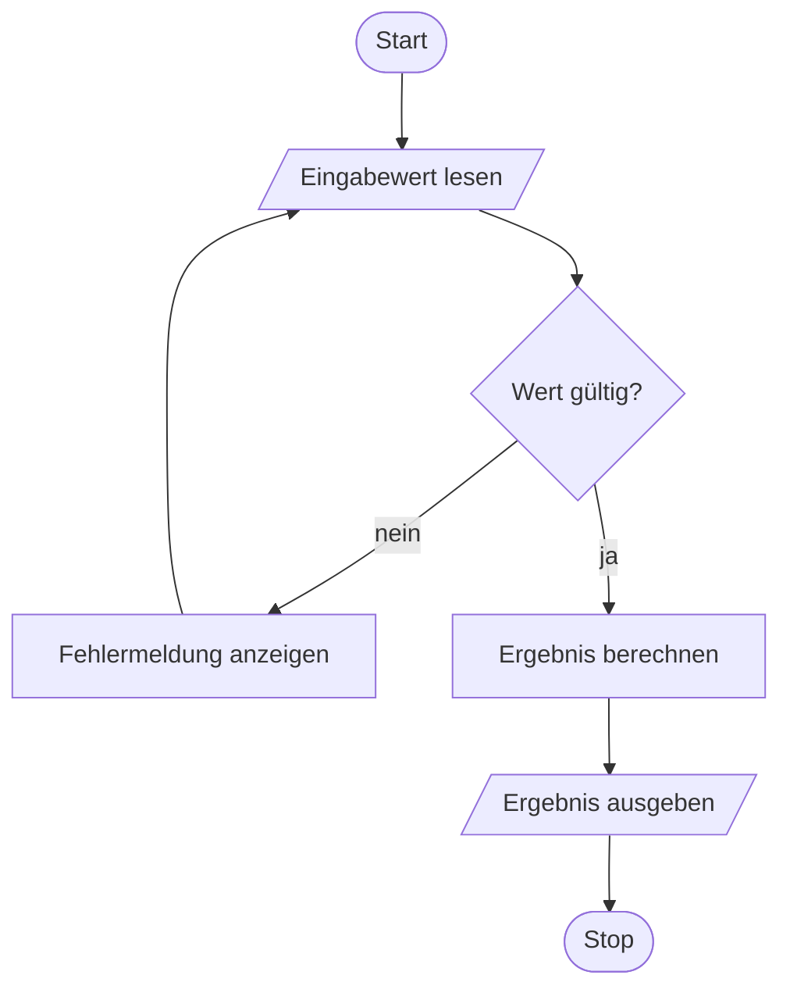

# Programmablaufplan — Eingabeprüfung (Beispiel, DIN 66001)

Eingebunden im Anhang als `assets/diagrams/programmablaufplan.png` (Abbildung `fig:pap-beispiel`).
Rendern: Mermaid-Block in [mermaid.live](https://mermaid.live) einfügen, als PNG exportieren und
unter demselben Namen neben dieser Datei ablegen.

Regeln nach den Prüfervorgaben (`.claude/instructions/vorgaben.md`, Abschnitt Abbildungen):

| Element | Mermaid | Eingänge | Ausgänge |
|---------|---------|----------|----------|
| Start-/Stop-Terminator | `([Text])` | Start 0, Stop 1 | Start 1, Stop 0 |
| Verzweigung (Raute) | `{Text}` | mind. 1 | genau 2 (beschriftet) |
| Ein-/Ausgabe | `[/Text/]` | mind. 1 | genau 1 |
| Verarbeitung | `[Text]` | mind. 1 | genau 1 |

Keine offenen Ablaufenden. Bei einer absichtlichen Endlosschleife steht der Stop-Terminator trotzdem
im Diagramm und wird als „nicht erreicht" kommentiert.

