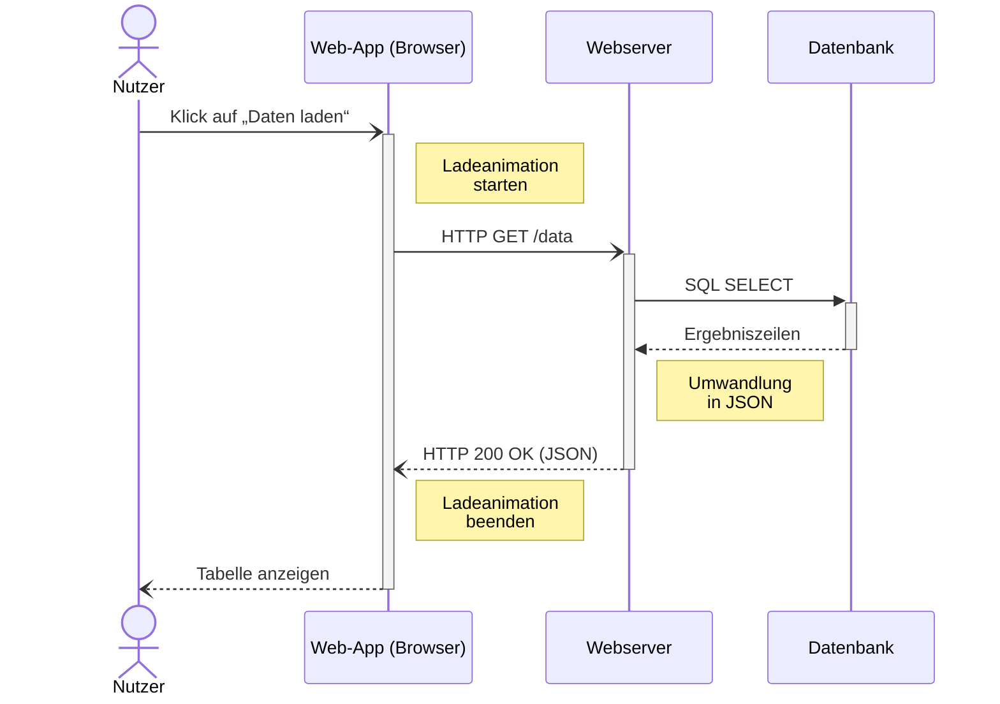

# Sequenzdiagramm — Datenabfrage (Beispiel)

Eingebunden in Kapitel 4 als `assets/diagrams/sequenzdiagramm.png` (Abbildung `fig:sequenz-beispiel`).
Rendern: Mermaid-Block in [mermaid.live](https://mermaid.live) einfügen, als PNG exportieren und
unter demselben Namen neben dieser Datei ablegen.

Pfeilsyntax nach den Prüfervorgaben (`.claude/instructions/vorgaben.md`, Abschnitt Abbildungen):

| Mermaid | Darstellung | Bedeutung |
|---------|-------------|-----------|
| `->>`   | durchgezogen, ausgefüllte Spitze | synchrone Nachricht, der Sender blockiert bis zur Antwort |
| `-)`    | durchgezogen, offene Spitze      | asynchrone Nachricht, der Sender blockiert nicht |
| `-->>`  | gestrichelt, ausgefüllte Spitze  | Antwort auf eine synchrone Nachricht |
| `--)`   | gestrichelt, offene Spitze       | Antwort auf eine asynchrone Nachricht |

`+`/`-` am Pfeil zeichnen die Aktivierungsbalken: Sie zeigen, wann ein Teilnehmer arbeitet oder
blockiert ist. An Netzwerknachrichten steht das Protokoll. Interne Schritte ohne Nachricht an einen
anderen Teilnehmer stehen als Notiz (`Note right of …`), nicht als Selbstaufruf — dessen Beschriftung
überlappt in Mermaid mit dem Aktivierungsbalken. Längere Notizen mit ` ` umbrechen, sonst
wird der Text abgeschnitten.

